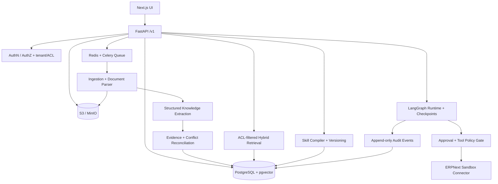

   # Technical Architecture

**Version:** 0.1 | **Stage:** Target design, not implemented

## 1. Design principles

1. **Evidence before automation.** Model output is a proposal, not a source of authority.
2. **Permissions are inherited and enforced twice:** at retrieval and action execution.
3. **History is append-only for decisions and approvals.** Never overwrite what a prior agent used.
4. **Typed data and tools, not unconstrained agent commands.**
5. **Modular monolith first.** Split into services only after load and operational evidence.
6. **Explicit lifecycle states.** No silent transitions from draft to approved/published.

## 2. Logical diagram



## 3. Deployment units

- `web`: Next.js UI.
- `api`: FastAPI application.
- `worker`: Celery processes for parsing, extraction, refresh and evaluation.
- `postgres`: PostgreSQL + pgvector.
- `redis`: jobs and short-lived coordination only, **not** sole durable approval state.
- `minio`: local object store; replace with managed S3 in production.
- `reverse-proxy`: local optional; required HTTPS in deployed demo.

Use database transactions/outbox-style action records to avoid lost state between approval, execution, and audit. LangGraph checkpoints must use a durable backend.

## 4. Core data model

Every table holding tenant content has immutable `id`, `org_id`, `created_at`, `updated_at` and appropriate unique constraints. Do not rely on tenant-filtering in the frontend.

| Table | Important fields / invariants |
|---|---|
| `organizations` | id, name, policy settings |
| `users` / `memberships` | provider identity, org role, active/revoked status |
| `connectors` | type, encrypted credential reference, sandbox flag, scopes, sync cursor |
| `sources` | kind, external key, owner, ACL policy, status, current_version_id |
| `source_versions` | source_id, checksum, captured_at, effective_at, blob_uri, immutable metadata |
| `chunks` | source_version_id, page/section/span offsets, text, `embedding vector(n)` with chosen model dimension |
| `knowledge_units` | type, normalized label, owner, logical current status |
| `knowledge_versions` | unit_id, exact claim JSON, source evidence, effective dates, review status, reviewer |
| `evidence_links` | knowledge_version_id, source_version_id, chunk/span, link type, extractor version |
| `entities` | type, canonical name, external references, ACL |
| `relationships` | src entity/unit, predicate, dst entity/unit, evidence link, status |
| `conflicts` | knowledge version A/B, severity, rationale, disposition, reviewed_by |
| `skills` / `skill_versions` | name, version, content, digest, dependency snapshot, status, reviewer |
| `runs` / `run_events` | skill version, user, ticket, execution state, trace, idempotency identifiers |
| `approvals` | run/action binding, allowed scope, decision, actor, expiry, ticket version |
| `audit_events` | actor, action, resource, outcome, timestamp, correlation ID, tamper-evident hash chain option |

**Indexes:** org_id in all tenant queries; source checksum uniqueness scoped to org/source; keyword GIN indexes; pgvector HNSW index sized after dataset tests; indexes for relationship endpoints, skill dependencies and unresolved conflicts.

**ACL policy:** grant by membership/role and optional source-specific principals; on extraction, a knowledge unit inherits the intersection/restrictive union policy of supporting sources (never broaden access). If a rule draws from multiple sources, serve only evidence and claims that the requester is authorized to see; otherwise abstain. Consider PostgreSQL row-level security as defense-in-depth, not a substitute for API checks.

## 5. Ingestion and knowledge lifecycle


### Parsing contract

Parser output includes `text`, `page`, `section`, `start_offset`, `end_offset`, `source_version_id`, and file-type/parser version. Do not drop page numbers for PDF-derived evidence. Original blobs remain addressable to authorized reviewers.

### Extraction contract

Structured schema: `{kind, subject, predicate, object, qualifiers, scope, effective_from, effective_to, evidence_spans, proposed_owner}`. Require `evidence_spans.length >= 1`. Reject malformed or unsupported extractions. Flag inferred owners as unverified.

### Reconciliation rules

- Duplicate: same semantically equivalent claim, scope, and time context.
- Contradiction: incompatible claims with overlapping effective scope/date; candidate only until review.
- Supersession: requires documentary authority or owner confirmation, with links to prior versions.
- Conflict blocks dependent skill publishing when severity `critical`.
- On source change/removal, recompute dependent knowledge; mark impacted skills `needs_review` and prevent affected write execution until republished.

## 6. Retrieval / answer architecture

1. Authenticate user; derive membership and allowed source IDs/ACL predicates **server-side**.
2. Normalize query; perform keyword search and pgvector semantic search with authorization filters applied before ranking/return.
3. Re-rank candidate approved knowledge versions and evidence chunks; include effective dates and ownership.
4. Produce an answer with structured citation IDs and per-claim source spans, or abstain when unsupported/disputed.
5. Verify citations refer to records authorized for this user; return source links through expiring authorized endpoint URLs.

**No unrestricted direct query-to-SQL access.** Never return embeddings or hidden document text as a side channel.

## 7. Skill compiler

`SkillDraft` input = selected approved process version + approved dependencies + tool catalog + allowed action policy. Compiler creates:

- `SKILL.md` with purpose, preconditions, ordered steps, exception handling, approval checkpoints and source snapshot.
- `manifest.json` with `skill_id`, semantic version, digest, immutable source-version IDs, allowed tool names, required roles, tests and expiration/review status.
- `tests.json` containing happy path, contradictory policy, missing permission, missing evidence, approval rejection and duplicate-action cases.

An owner must approve an immutable content hash. Publish state machine: `draft → review → published → needs_review | deprecated`. Any edit creates a **new** draft version. A file is agent instructions, **not** an authorization token.

## 8. Workflow / tool execution

Initial graph nodes:

```text
START -> authorize_run -> load_ticket -> retrieve_current_policy
      -> check_required_data -> draft_plan -> policy_gate
      -> wait_for_human_approval -> revalidate_ticket_and_skill
      -> execute_allowlisted_action -> verify_result -> audit -> END
```

Branch to `escalated/failed/aborted` on uncertain policy, missing data, denied approval, changed ticket or connector error. Runtime stores snapshots/checkpoints and produces a readable trace. Do not silently auto-retry side-effecting operations.

**Tool contract example:**

```json
{
  "name": "update_ticket_status",
  "arguments": {"ticket_id": "HD-TICKET-0001", "status": "Resolved"},
  "required_role": "support_agent",
  "requires_approval": true,
  "idempotency_key": "run-id:action-id",
  "expected_ticket_revision": "rev-123"
}
```

The backend derives `org_id`, actor, and approved tool scopes. It MUST NOT trust those values from LLM output. Block any target URL except pinned authorized ERPNext hosts to mitigate SSRF. No general shell, SQL, HTTP fetch, or browser tools in the runtime.

## 9. Proposed API (v1)

All endpoints require authorization and are namespaced under `/api/v1`; all paginated endpoints use cursor pagination.

| Method | Path | Purpose |
|---|---|---|
| POST | `/sources/upload` | Upload document; return source and job ID |
| GET | `/sources` | Source listing and status |
| GET | `/sources/{id}/versions/{versionId}` | Authorized source/provenance |
| GET | `/jobs/{id}` | Ingestion status and errors |
| GET | `/knowledge` | ACL-filtered units, status and filters |
| POST | `/knowledge/{id}/review` | Approve/reject with expected version |
| GET | `/conflicts` | Pending conflicts |
| POST | `/conflicts/{id}/resolve` | Owner-reviewed resolution |
| POST | `/ask` | Answer + citations or abstention |
| POST | `/skills/drafts` | Compile reviewed process into skill draft |
| POST | `/skills/{id}/versions/{v}/publish` | Publish approved immutable version |
| GET | `/skills/{id}/versions/{v}/export` | Authorized zipped skill export |
| POST | `/connectors/erpnext/test` | Verify sandbox connection and scopes |
| POST | `/runs` | Start approved skill against permitted ticket |
| GET | `/runs/{id}` | State and audit-friendly trace |
| POST | `/runs/{id}/approvals/{approvalId}` | Approve/reject exact action proposal |
| GET | `/audit-events` | Authorized audit listing |

Example `/ask` response:

```json
{
  "answer": "The support team must request finance approval for this case.",
  "status": "answered",
  "citations": [{"source_version_id": "sv_01", "page": 2, "span": [145, 198]}],
  "knowledge_version_ids": ["kv_02"]
}
```

For insufficient/restricted/disputed evidence: `{"answer":null,"status":"insufficient_evidence","citations":[]}`.

## 10. Security and privacy boundaries

- Separate org identity from user identity; least-privilege memberships and source ACLs.
- Encrypt connector credentials using a managed key/secret store; redact from telemetry and API responses.
- Validate uploaded files with size/type limits, malware scanning where available, and isolated parsing workers. No macro execution.
- Treat retrieved content as hostile to prompts; only fixed system instructions and reviewed skills determine actions.
- Restrict outbound integrations by host allowlist; use sandbox data in MVP.
- Require authenticated, one-time, expiring approvals tied to exact action parameters and latest ticket revision.
- Rate-limit endpoints, LLM tokens and connector actions by org.
- Support deletion workflow: original blobs, chunks, embeddings, derived unsupported knowledge, and retention-aware audit record handling.
- Keep traceable LLM provider, prompt template and model versions; minimize PII in prompts.

## 11. Observability and failure modes

Track `job_id`, `source_version_id`, `run_id`, `skill_version_id`, `trace_id` and reviewer IDs. Metrics: ingest failures, citation validation rate, conflicting records, stale skills, token cost, blocked actions, approval latency, action failures. Failed/unknown ERPNext write outcomes are **not** auto-retried; check remote state with a read-only query before manually reconciling.

## 12. Scalability path

At larger volume, add incremental connectors and tuned retrieval, then consider Qdrant or Neo4j only after profiling. Do not add extra distributed stores in the first release.
